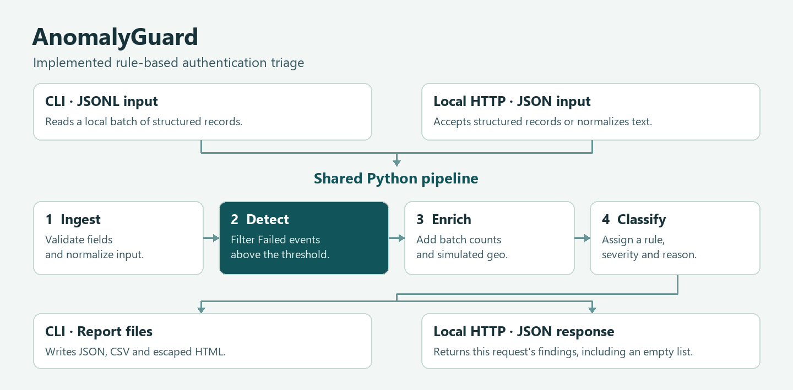

# AnomalyGuard

A Washington State University CptS 483 project for **rule-based authentication triage**. AnomalyGuard takes a batch of events, flags failed authentication records above a threshold, and records which rule assigned each finding its severity. Use the CLI to produce JSON, CSV, and HTML reports, or send a batch to the local Flask interface.

[Read the SOC case study](docs/soc-case-study.md) · [View the generated HTML report](docs/evidence/synthetic-findings.html) · [Inspect the input](examples/synthetic-auth.jsonl) · [Download the CSV](docs/evidence/synthetic-findings.csv)



## Verified capabilities

- **Ingest and validate** JSONL files or JSON requests. The HTTP endpoint also accepts text lines and derives a basic failure status and heuristic score from keywords.
- **Detect** events only when status is exactly `Failed` and the score is strictly above the threshold. The CLI takes scores from the input. Those scores are inputs to the rule, not probabilities.
- **Enrich** flagged events with batch-local counts and normalized event time where available. Missing or unparseable event times stay unknown. Geographic labels are **simulated IP-prefix labels**.
- **Classify** findings with a rule, severity, and reason. **FailedLoginSpike** is high. **RepeatedSourceIP** and **HighScoreOutlier** are medium. **Other** is low.
- **Report** a complete result for each CLI run, including an empty report. Each HTTP response contains only that request’s findings and does not write report files.

The supplied synthetic exercise processed **9 events** and flagged **7** at a CLI threshold of **0.7**. The seven findings were three failed-login spikes, three repeated-source findings, and one high-score outlier. The original successful login remains in the input and is excluded by the detection rule.

## Run locally

The verified environment used Python 3.12. On Windows PowerShell:

```powershell
python -m venv .venv
$python = (Resolve-Path .venv/Scripts/python.exe).Path
& $python -m pip install -r requirements.txt
& $python -m src.main --input examples/synthetic-auth.jsonl --threshold 0.7 --output reports/synthetic-findings
```

The last command writes three files under `reports/`. Download the linked HTML report and open it locally to see the rendered table. GitHub may display the file as source.

To try the local HTTP interface, run `& $python -m src.mcp_server` in the first terminal, then run:

```powershell
Invoke-RestMethod http://127.0.0.1:8765/health
$lines = @(Get-Content examples/synthetic-auth.jsonl | ForEach-Object { ConvertFrom-Json $_ })
$body = @{ lines = $lines } | ConvertTo-Json -Depth 6
Invoke-RestMethod http://127.0.0.1:8765/ingest -Method Post -ContentType application/json -Body $body
```

The service uses the original HTTP threshold of **0.5**. It defaults to localhost with debug off and limits requests to **1 MiB** and **1,000 array events**. Keep it local and use authorized, non-sensitive data. Use `--debug` only for local development.

## Tests and architecture

```powershell
& $python -m pip install -r requirements-dev.txt
& $python -m pytest -ra
```

The [architecture notes](docs/architecture.md) map the pipeline stages to their source files and explain rule precedence. The [verification record](docs/verification.md) documents the tested versions and full suite breakdown.

## Scope and credits

This is an analyst-led coursework prototype. It has no historical event correlation, authentication, threat-intelligence feed, runtime LLM, trained model, MCP protocol server, or n8n workflow. The HTTP filename `mcp_server.py` is retained for compatibility. It exposes a Flask JSON API.

The original course repository referenced the separate [Log Analyzer project](https://github.com/darasimiop/log-analyzer). The reviewed CLI and HTTP pipeline do not import it, so this portfolio copy includes neither that submodule nor its adapter. Course materials and the HW05 prototype are outside this portfolio copy. See the [architecture notes](docs/architecture.md) for what was verified and what remains a future idea.
