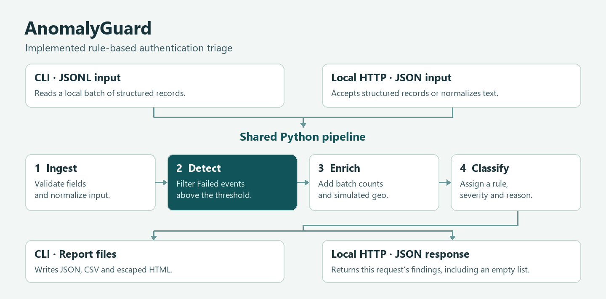

# Implemented architecture

| Stage | Component | Responsibility |
| --- | --- | --- |
| Coordinator | [src/main.py](../src/main.py) | Runs the shared batch pipeline. The CLI reads a file, invokes the stages, and writes reports. |
| Ingestion | [src/ingest.py](../src/ingest.py) | Validates field types and finite scores between 0 and 1. JSONL can preserve plain-text lines as unscored evidence. HTTP text ingestion assigns a simple score and does not assign an event time. |
| Detection | [src/detection.py](../src/detection.py) | Selects exact `Failed` status with a score strictly above the chosen threshold. The default is 0.8 on the CLI and 0.5 on HTTP. |
| Enrichment | [src/enrichment.py](../src/enrichment.py) | Calculates the greater of user and source-IP occurrence counts within the flagged batch. Parses compatible timestamps and preserves unknown times. Labels geography as simulated. |
| Classification | [src/classifier.py](../src/classifier.py) | Assigns the first matching rule, severity, and reason. |
| Reporting | [src/reporting.py](../src/reporting.py) and [src/mcp_server.py](../src/mcp_server.py) | The CLI emits JSON, CSV, and escaped HTML. The HTTP route returns a fresh JSON envelope without storing request or report files. |

## Classification order

| Priority | Label | Severity | Condition |
| --- | --- | --- | --- |
| 1 | FailedLoginSpike | High | A user occurs in at least three flagged rows whose event text matches a failure keyword. |
| 2 | RepeatedSourceIP | Medium | The source IP occurs in at least three flagged rows. |
| 3 | HighScoreOutlier | Medium | The supplied or heuristic score is at least 0.9. |
| 4 | Other | Low | No earlier rule matches. |

The classifier counts a whole flagged batch. It does not enforce a time window or correlate batches. Geographic values are placeholders derived from IP prefixes. The enrichment counts and severity labels should guide analyst review within those limits.

## Boundaries and future work

The HTTP interface supports local experimentation and has no authentication, persistence, production rate limiting, telemetry integrations, or network reputation lookup. The text parser uses substring matches and extracts IPv4-like tokens. It is suitable for small labeled examples. The CLI does not impose the HTTP batch limit and writes to the specified output prefix. Reusing that prefix overwrites its report files.

Future work could include event schemas for other sources, real enrichment with provenance, time-window correlation, an authenticated deployment, an n8n workflow, an MCP tools adapter, or a separately evaluated ML or LLM component. These do not form part of the verified workflow.
